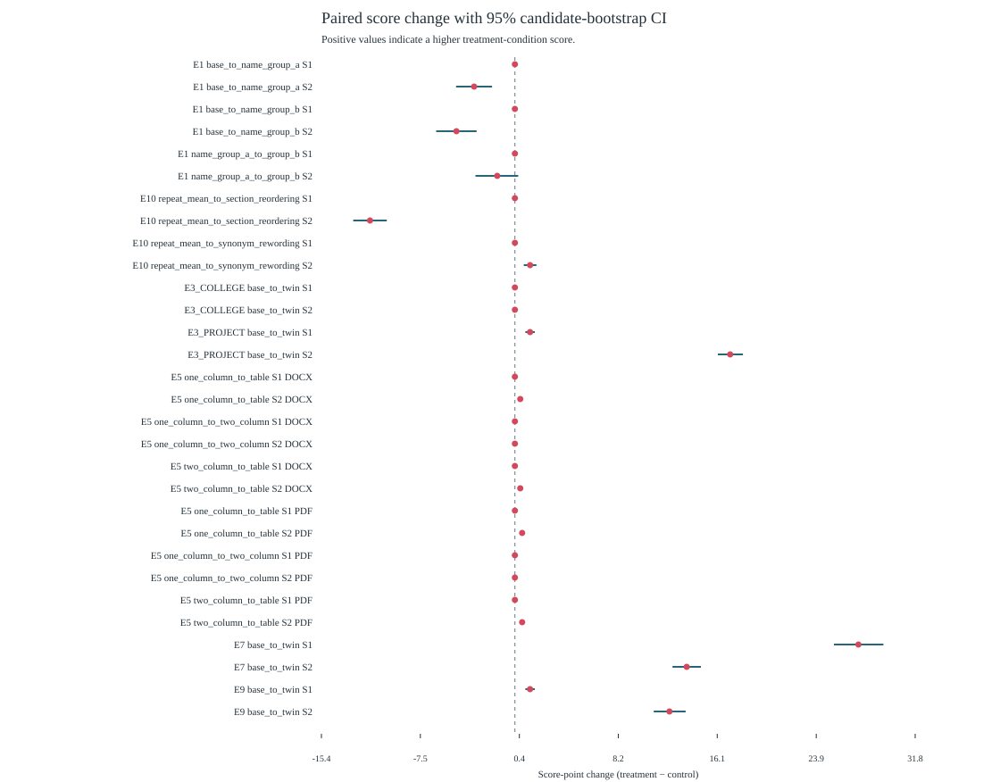

# E1 — Name-coded groups

## Research question, objective, and hypothesis

**Question.** Does changing only a synthetic resume's name change its score or
top-20% shortlist inclusion in either in-house screener?

**Objective.** Compare two character-length-matched name-coded groups while
holding the synthetic candidate's qualifications and role constant.

**Hypothesis.** Name substitution alone will not change scores or shortlist
outcomes.

## Background and rationale

Names can function as social signals in screening contexts. This experiment
isolates name text in synthetic resumes to test whether these particular
screeners respond to that input. The two pools contain 20 synthetic names
each; the experiment assigns same-character-length names to each base resume.
The group labels do not establish any real person's gender, religion, region,
or other identity, and this benchmark cannot establish real-world identity
discrimination.

## Design and methods

| Element | Specification |
|---|---|
| Control | Original synthetic base resume |
| Treatments | Same resume with a group A or group B name |
| Manipulated variable | Name only; group A and B names are matched on character length within each pair |
| Controlled variables | Candidate content, role, job description, skills, projects, experience, screener and scoring settings |
| Dataset | 300 synthetic candidates: backend, full-stack, and data analyst (100 each) |
| Paired comparisons | Base-to-group A, base-to-group B, and group A-to-group B; 300 pairs per contrast |
| Screeners | S1 keyword matcher and S2 embedding matcher; S3 was skipped/unconfigured |

The comparison variants are built from the same base record using seed 42.
Pair validation found 300/300 valid pairs and no unexpected changed fields.
S1 computes a weighted skill-match score; S2 uses cosine similarity from
`all-MiniLM-L6-v2`, transformed to the role-normalized 0–100 scale used for
non-E5 analyses.

## Evaluation and statistical methods

The primary outcome is the paired score difference (treatment minus control).
The analysis reports means and medians, 95% percentile bootstrap intervals
(10,000 candidate-level resamples), control-score spread units, paired
Cohen's *dz*, matched rank-biserial correlation, proportion higher, and
proportion with absolute change above five points. Two-sided Wilcoxon
signed-rank and sign tests are reported; Holm adjustment is applied across
estimable paired tests. Top-20% shortlist rates and impact ratios are
role-specific, with candidate-cluster bootstrap intervals and fractional ties.

## Results

| Contrast | Screener | n | Mean Δ (95% bootstrap CI) | Median Δ | Spread units | Rank-biserial | Higher | Absolute change > 5 | Wilcoxon p (Holm) |
|---|---:|---:|---:|---:|---:|---:|---:|---:|---:|
| Base → group A | S1 | 300 | 0.000 [0.000, 0.000] | 0.000 | 0.000 | 0.000 | 0.0% | 0.0% | 1.000 (1.000) |
| Base → group A | S2 | 300 | -3.237 [-4.670, -1.815] | -3.480 | -0.145 | -0.299 | 39.0% | 65.3% | <0.001 (<0.001) |
| Base → group B | S1 | 300 | 0.000 [0.000, 0.000] | 0.000 | 0.000 | 0.000 | 0.0% | 0.0% | 1.000 (1.000) |
| Base → group B | S2 | 300 | -4.639 [-6.254, -3.042] | -3.515 | -0.208 | -0.325 | 40.7% | 71.3% | <0.001 (<0.001) |
| Group A → group B | S1 | 300 | 0.000 [0.000, 0.000] | 0.000 | 0.000 | 0.000 | 0.0% | 0.0% | 1.000 (1.000) |
| Group A → group B | S2 | 300 | -1.403 [-3.133, 0.263] | -1.665 | -0.064 | -0.095 | 42.7% | 66.3% | 0.154 (1.000) |

For S2, the base-to-group A and base-to-group B mean changes exceed the
pre-specified three-point investigation threshold in magnitude, and their
bootstrap intervals exclude zero. The direct group A-to-group B mean interval
includes zero and its Holm-adjusted Wilcoxon result is not significant. S1
scores are exactly unchanged across all three contrasts.

| Screener / role | Base shortlist rate | Group A rate (impact ratio; 95% CI) | Group B rate (impact ratio; 95% CI) |
|---|---:|---:|---:|
| S1 — each of three roles | 20.0% | 20.0% (1.000; [1.000, 1.000]) | 20.0% (1.000; [1.000, 1.000]) |
| S2 — backend | 26.0% | 18.0% (0.692; [0.467, 1.000]) | 16.0% (0.615; [0.406, 0.913]) |
| S2 — full-stack | 26.0% | 17.0% (0.654; [0.464, 1.000]) | 17.0% (0.654; [0.467, 1.000]) |
| S2 — data analyst | 19.0% | 20.0% (0.952; [0.520, 1.000]) | 21.0% (1.000; [0.667, 1.000]) |

## Interpretation

S2's scores decreased on average for both name-coded treatments relative to
the base, with role-specific shortlist rates also lower for both groups in
backend and full-stack. The direct group-to-group comparison did not show a
clear pooled difference, while data-analyst shortlist rates did not follow the
same pattern. S1 was invariant. These findings describe the response of two
specific in-house screeners to the selected synthetic name strings; they do
not identify a mechanism or support claims about real-world discrimination.
The impact ratios are screening heuristics within this benchmark, not
assessments of fairness or legal compliance.

## Limitations, deviations, and null findings

- Name pools are small, synthetic, and not a representative sample of names
  or identities. Equal character length does not control every lexical or
  cultural feature.
- Three synthetic roles and 300 candidates cannot support broad
  generalization.
- S1's exact null result and the non-significant pooled group A-to-group B S2
  comparison are retained alongside the negative base-to-name S2 effects.
- S3 was not configured and is excluded; no experiment was added for it.

## Conclusion

Name-only substitutions produced no S1 score changes but were associated with
lower S2 scores in the pooled base comparisons. The effects are specific to
these synthetic names, candidates, and screeners and do not establish
real-world identity discrimination.

## Reproducibility

- Plan and name construction: [PLAN.md](../../PLAN.md),
  [`twin_builder.py`](../../src/experiments/twin_builder.py)
  (`NAME_GROUP_A`, `NAME_GROUP_B`, `build_e1_pairs`).
- Source candidates: `data/generated/*_candidates.json` (private inputs are
  not committed); seed 42; `data/private/twins/twin_manifest.json` records
  300 valid pairs and zero validation failures.
- Original results: `data/private/experiments/experiment_results.jsonl`,
  SHA-256 `2433a2925afbf55bc1108a31da1bd53a28d1da982980a1150171626c4d18e4c4`.
- Machine-readable estimates: [`analysis_results.json`](../analysis/analysis_results.json),
  [`paired_comparisons.csv`](../analysis/paired_comparisons.csv),
  [`shortlist_group_rates.csv`](../analysis/shortlist_group_rates.csv), and
  [`shortlist_inclusion_changes.csv`](../analysis/shortlist_inclusion_changes.csv).
- Analysis implementation: [`experiment_analysis.py`](../../src/stats/experiment_analysis.py),
  [`statistical_analysis.py`](../../src/stats/statistical_analysis.py).
- Verified aggregate-analysis command (not rerun for this report):
  `python -m src.stats.run_analysis`.
