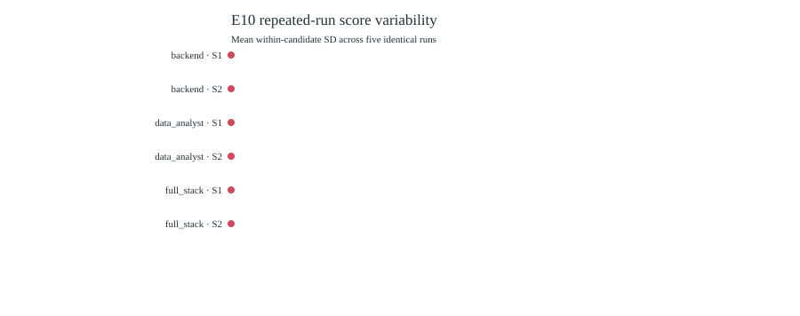

# E10 — Repeated-run stability

## Research question, objective, and hypothesis

**Question.** Does the same unchanged synthetic resume receive the same score
across repeated runs of each screener?

**Objective.** Quantify within-candidate score variability and ranking
reliability across five runs of identical inputs.

**Hypothesis.** Identical input to a fixed screener will produce identical
scores, rankings, and top-20 membership.

## Background and rationale

Screening decisions can be sensitive to nondeterministic model behavior or
execution settings. E10 therefore separates repeated identical inputs from
the section-reordering and synonym-rewriting variants, which are documented
in their own reports.

## Design and methods

| Element | Specification |
|---|---|
| Control | Same candidate resume and job description, repeated five times |
| Treatment | None; this is a repeated-measure reliability study |
| Manipulated variable | Run instance only; input text and settings held fixed |
| Controlled variables | Candidate, role, job description, screener/model and scoring method |
| Dataset | 300 candidates, 100 in each of backend, full-stack and data-analyst roles |
| Repeated observations | Five runs per candidate and screener; 1,500 observations per screener |
| Screeners | S1 and S2; S3 was skipped/unconfigured |

The experiment runner uses five result records for each E10
`identical_control` condition. S1 is the deterministic weighted keyword
matcher. S2 encodes the resume and job description with
`all-MiniLM-L6-v2`; identical inputs are cached and cosine similarity is
rounded to six decimal places.

## Evaluation and statistical methods

Stability is summarized using mean within-candidate standard deviation and
its candidate-bootstrap 95% interval, median standard deviation, candidate
range, percent of candidates with exactly stable scores, ICC(2,1)
absolute agreement, mean and minimum pairwise run-rank Spearman correlation,
and top-20 overlap. The existing stability table contains 100 candidates
for each role/screener. Repeated-run statistics are descriptive reliability
measures; there is no treatment-control hypothesis test for this contrast.

## Results

| Screener | Role | n | Runs/candidate | Mean within-candidate SD (95% bootstrap CI) | Median SD | Exactly stable candidates | ICC(2,1) | Pairwise run ρ | Top-20 overlap |
|---|---|---:|---:|---:|---:|---:|---:|---:|---:|
| S1 | Backend | 100 | 5 | 0.000 [0.000, 0.000] | 0.000 | 100.0% | 1.000 | 1.000 | 1.000 |
| S1 | Full-stack | 100 | 5 | 0.000 [0.000, 0.000] | 0.000 | 100.0% | 1.000 | 1.000 | 1.000 |
| S1 | Data analyst | 100 | 5 | 0.000 [0.000, 0.000] | 0.000 | 100.0% | 1.000 | 1.000 | 1.000 |
| S2 | Backend | 100 | 5 | 8.14e-16 [3.97e-16, 1.31e-15] | 0.000 | 100.0% | 1.000 | 1.000 | 1.000 |
| S2 | Full-stack | 100 | 5 | 8.74e-16 [4.37e-16, 1.39e-15] | 0.000 | 100.0% | 1.000 | 1.000 | 1.000 |
| S2 | Data analyst | 100 | 5 | 6.45e-16 [2.48e-16, 1.11e-15] | 0.000 | 100.0% | 1.000 | 1.000 | 1.000 |

S2's recorded mean standard deviations are approximately
`8.14e-16`, `8.74e-16`, and `6.45e-16` points by role—floating-point
precision effects, not meaningful score variability. Its observed exact
stability rate is nevertheless 100.0% for each role.

## Interpretation

Both screeners were stable on repeated identical inputs in this execution
setup. S1 scores were exactly constant; S2 differed only at negligible
floating-point scale and retained identical rounded outcomes, ranks, and
shortlists. This does not imply stability across different software
versions, machines, model implementations, prompts, or non-identical inputs.

## Limitations, confounders, deviations, and null findings

- Only five runs, 300 synthetic candidates and two screeners were evaluated.
- The embedding implementation reuses cached embeddings for identical text;
  this test measures repeated calls in that implementation, not independent
  model reloads or hardware variation.
- There was no observed meaningful variability; this null result should be
  interpreted within these fixed conditions.
- S3 was unconfigured and excluded.

## Conclusion

In the recorded five-run test, S1 and S2 produced stable scores and rankings
for identical inputs. The result is not a guarantee of reliability under
other execution conditions.

## Reproducibility

- E10 construction and repeat count:
  [`experiment_runner.py`](../../src/experiments/experiment_runner.py)
  (`identical_control` handling) and
  [`twin_builder.py`](../../src/experiments/twin_builder.py)
  (`build_e10_pairs`).
- Source results:
  `data/private/experiments/experiment_results.jsonl`,
  SHA-256 `2433a2925afbf55bc1108a31da1bd53a28d1da982980a1150171626c4d18e4c4`.
- Machine-readable stability estimates:
  [`analysis_results.json`](../analysis/analysis_results.json),
  [`stability_repeated_runs.csv`](../analysis/stability_repeated_runs.csv).
- Shared analysis command:
  `python -m src.stats.run_analysis` (documented, not rerun for this report).
